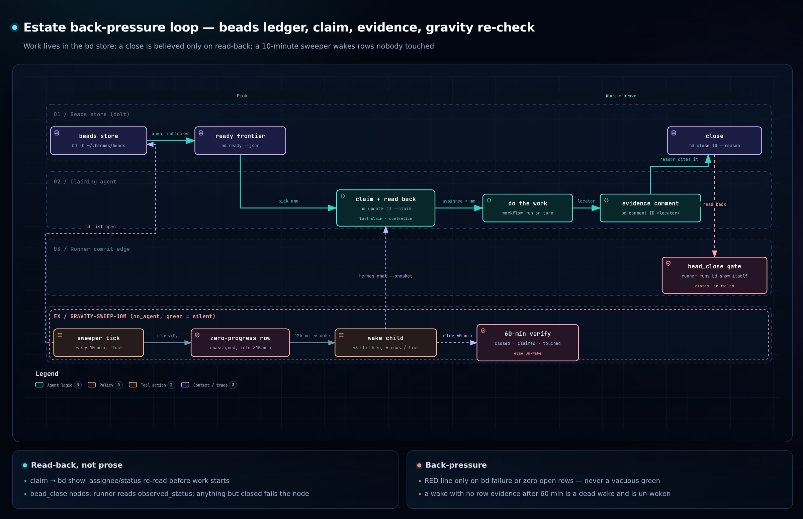
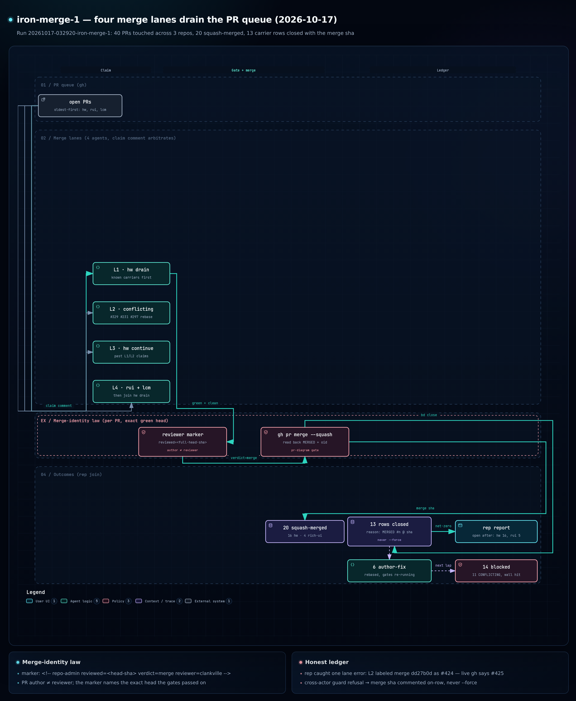
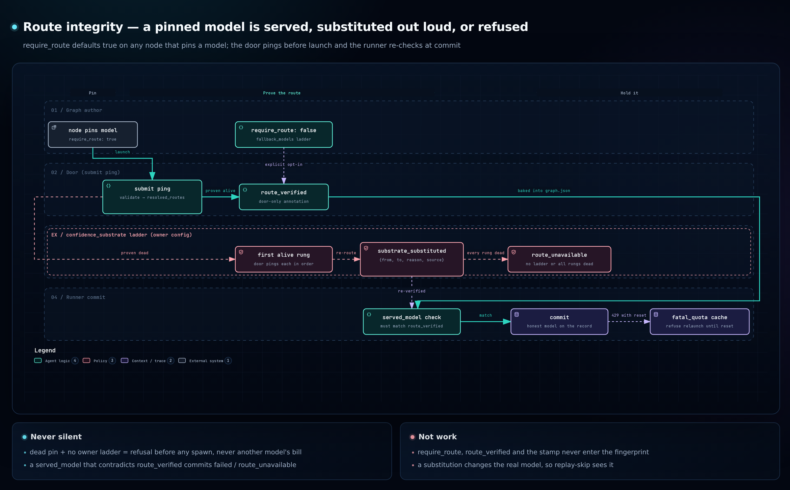

# Showcase — four diagrams, four claims

Each picture is derived from a checked-in archify spec JSON (same name,
`.workflow.json`, beside the PNG under `docs/pr-diagrams/`): the JSON is the
re-derivable truth, the PNG is the human face. Re-render with
`node <archify>/bin/archify.mjs finalize workflow <spec>.json <out>.html
--quality standard`. What each picture asserts, in two lines:

## 1. The graph lifecycle — what one run does

The door validates and pings routes before a launch is admitted; the runner is
one kernel-flock'd process, no daemon. Lanes fan out, a gate parks the run at
zero tokens, `amend` swaps the graph mid-flight — fingerprint-matched nodes
replay instead of re-paying.

## 2. Estate back-pressure — the same loop at the work-ledger scale

Work lives in one store (`bd ready` is the frontier, `--claim` + read-back is
the door) and a close is believed only when the runner re-reads the row itself.
A 10-minute no_agent sweeper wakes zero-progress rows, and a wake that produces
no row evidence after 60 minutes is un-woken — back-pressure, not a queue.

## 3. A real production shape — the iron-merge wave of 2026-10-17

Four agent lanes took the open-PR queue oldest-first against an arbitration
protocol (claim comments, merge marker at the exact green head,
`author ≠ reviewer`); the run's ledger: 40 PRs touched, 20 squash-merges,
13 carrier rows closed with the merge sha, 6 left author-fix, 14 left blocked.
The identity law is the picture's spine: no merge without a marker naming the
head the gates passed, and no lane reviewing its own work.

## 4. Route integrity — the fail-closed model pin

A node that pins a `model` launches on that model or not at all: the door pings
before spend, and a proven-dead pin is a typed `route_unavailable`, never a
silent substitution. The only sanctioned fallback is the owner-configured
`confidence_substrate` ladder, and a ride down it is engine-stamped and
disclosed in the node's own result.
